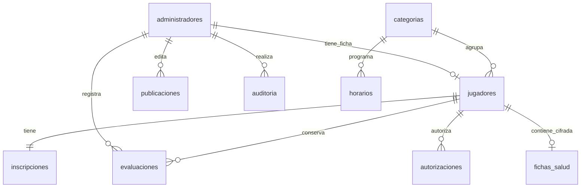

# Arquitectura de integrantes y roles

Se mantiene el monolito PHP con PDO y HTML renderizado en servidor. No se sustituyó el sistema anterior ni se añadieron dependencias de framework. `MemberController` coordina inscripción, búsqueda y secciones de ficha; `AccountController` gestiona configuración, cuentas, contraseña y auditoría. `MemberFields` define campos permitidos, límites y validación; los formularios utilizan esa definición sin aceptar nombres SQL desde el cliente.

## Modelo ampliado

`administradores` conserva su nombre por compatibilidad con cuentas y FK anteriores, pero representa usuarios de los tres roles. `academia_config` tiene una fila con identidad/contacto/política. `migraciones` registra ampliaciones. `contenidos_institucionales` y `solicitudes` mantienen sus responsabilidades anteriores.

## Controles por petición

1. Inicializar sesión privada, cookies HttpOnly/SameSite, caducidad y cabeceras CSP/no-store.
2. Para rutas privadas, consultar de nuevo cuenta activa, rol y versión de sesión.
3. Redirigir a cambio de contraseña si es temporal; rechazar roles incompatibles con HTTP 403.
4. Validar CSRF antes de toda modificación, incluido registro público.
5. Para jugador, resolver `jugadores.id` desde su cuenta; nunca aceptar la ficha de otra persona por un `id` enviado. Staff utiliza un ID validado y su rol.
6. Autorizar la sección: asistente no consulta salud, jugador no escribe evaluaciones ni estados de inscripción.
7. Recolectar solo campos declarados; validar opciones, longitudes, fechas y números; persistir con parámetros PDO y transacciones.
8. Auditar acción sin contenido médico y redirigir tras POST. Escapar salida HTML.

Las escrituras de ficha bloquean su fila con `FOR UPDATE`. La revocación de salud y la edición usan el mismo bloqueo y vuelven a comprobar la autorización dentro de la transacción. Los tokens únicos de evaluación impiden un segundo registro del mismo formulario. La cuenta tiene correo único; el jugador usuario único y la inscripción jugador único.

## Autorizaciones y cifrado

Se conserva el texto de política aceptado, no solo una etiqueta cambiante. La ficha clínica es un JSON cifrado mediante OpenSSL AES-256-GCM. La representación almacenada es Base64 de IV de 12 bytes, etiqueta de 16 y ciphertext; AAD `player:<id>` impide reutilizar el ciphertext como ficha de otro integrante. Una etiqueta inválida o clave ausente provoca fallo cerrado, nunca entrega texto parcial.

La clave privada se crea una sola vez fuera de `public/`. No está en Git, ZIP, variables de JavaScript ni tabla de configuración. Los respaldos SQL conservan solo ciphertext para salud, pero otros campos personales están en claro bajo permisos de BD; por eso el respaldo completo sigue siendo sensible. Se requieren ACL del servidor y custodia de la clave; no se implementó KMS ni rotación automática.

## Rutas principales

| Ruta `r` | Acceso |
|---|---|
| registro | Público habilitado por configuración; administrador puede inscribir con referencia previa |
| mi-ficha | Jugador, ficha propia |
| equipo, equipo/ficha | Asistente o administrador; sección salud solo administrador con consentimiento |
| cuenta, logout | Todos los roles autenticados |
| admin/cuentas, admin/configuracion, admin/auditoria | Administrador |
| admin/contenido, admin/solicitudes | Administrador, como antes |

## Requisitos añadidos y aceptación

| ID | Comportamiento | Evidencia |
|---|---|---|
| MI01 | Registro con autorización y representante para menor | members.json: inscripción, consentimiento, menor |
| MI02 | Login por rol, aislamiento de ficha y revocación de sesión | members.json: permisos, IDOR, sesión revocada |
| MI03 | Contacto propio y ficha futbolística gestionada por staff | members.json: datos personales, asignación futbolística |
| MI04 | Evaluaciones fechadas, límites e historial sin duplicados | members.json: evaluación, peso, doble envío |
| MI05 | Inscripción con estados y referencia antes de activación | members.json: activación y actualización |
| MI06 | Salud opcional cifrada, consentimiento y revocación | members.json y recovery-health.json |
| MI07 | Cuentas, roles, cambio de contraseña temporal y auditoría | members.json: cuentas, contraseña, auditoría |
| MI08 | Identidad configurable y retirada de rótulos anteriores | members.json: portal limpio y marca configurable |

Las pruebas verifican controles concretos, no conformidad legal total ni seguridad absoluta. Consultar manual y pruebas v2 para los límites operativos.
