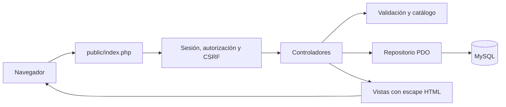

> Documento histórico de la versión 1 (11/11/2026). Para la versión actual con integrantes, roles y salud, consultar [integrantes](integrantes.md), [migración v2](migracion-v2.md) y [pruebas v2](pruebas-v2.md). Las restricciones y funciones descritas aquí corresponden al alcance anterior.

# Arquitectura y decisiones

## Alcance y fuente

Se tomó como especificación el texto adjunto del solicitante, con RF01–RF07 y RNF01–RNF06. No se suministró un documento maestro adicional. La correspondencia se limita a esa lista; debe contrastarse con el documento universitario definitivo antes de la sustentación.

Monolito modular con renderizado en servidor. PHP procesa la petición, PDO consulta MySQL y una vista produce HTML. JavaScript mejora navegación móvil, validación y prevención de doble clic; las reglas de aceptación siempre se ejecutan también en PHP. Se usa una conexión PDO por petición y zona horaria de Colombia.

## Responsabilidades

`PublicController` consulta registros visibles y registra solicitudes. `AuthController` verifica credenciales y limita intentos. `AdminController` sirve el panel, formularios de contenido y solicitudes. `Repository` concentra PDO, sin conocer HTML. `Catalog` define campos, tablas y opciones permitidas; evita cuatro controladores CRUD repetidos y nunca admite nombres de tabla provenientes de una entrada arbitraria. `Validation` es pura y puede probarse sin BD.

El punto de entrada usa rutas `index.php?r=...`, compatibles con PHP CLI y Apache sin Rewrite. Los módulos administrativos están bajo `admin` en la ruta lógica, no en un directorio duplicado. Las altas y modificaciones usan POST seguido de redirección 303. No hay borrados desde la UI: desactivación y despublicación mantienen relaciones y facilitan recuperar un cambio.

## Controles implementados

| Riesgo | Control | Límite |
|---|---|---|
| Inyección SQL | PDO sin emulación, valores enlazados, identificadores del catálogo cerrado | Nuevas consultas deben seguir el mismo patrón |
| XSS | Escape central `e`, texto plano, CSP sin scripts inline | No sustituye revisión de futuras vistas |
| CSRF | Token aleatorio de sesión, comparación `hash_equals` en cada POST | Requiere sesiones y cookies funcionales |
| Acceso privado | Comprobación de sesión y cuenta activa antes de rutas privadas | Un único rol administrador |
| Contraseñas | `password_hash`/`password_verify`, alta por CLI, stdin | Sin recuperación ni MFA; cuentas iniciales con acceso local |
| Sesiones | HttpOnly, SameSite=Lax, strict mode, regeneración al entrar, 30 minutos inactividad | Secure solo con HTTPS; ACL Windows deben configurarse |
| Fuerza bruta | Bloqueo de cuenta 15 minutos al acumular cinco fallos y límite adicional por sesión | No hay limitación por IP distribuida; bloqueo puede ser provocado por terceros |
| Reenvío | Token de envío único en BD, PRG, bloqueo del botón | No es un sistema anti-spam; nuevas sesiones pueden enviar nuevas solicitudes |
| Exposición | DocumentRoot `public`, archivos privados fuera; no-store en respuestas; errores genéricos | Configuración incorrecta del servidor puede anular el aislamiento |
| Datos | Solo ficción, correo `@example.com`, consentimiento y versión, solicitudes privadas | El texto libre no identifica automáticamente datos reales |

La sesión se guarda en `var/sessions`. El servidor registra una referencia y clase/código de excepción, sin contraseñas, mensajes ni SQL. No hay logging detallado de auditoría de cambios; `actualizado_en` y autor de última edición de publicación aportan trazabilidad limitada. La aplicación debe ejecutarse con cuenta de BD de privilegios mínimos; las herramientas de importación requieren privilegios temporales mayores.

## Diseño y accesibilidad

Azul `#10233F` como base institucional; verde ajustado a `#126F51` para mejorar contraste de botones blancos y enlaces; dorado `#E9B949` en pequeños acentos. Tipografía de sistema, sin llamadas externas. Escudo SVG y cancha CSS originales: no se descargaron fotografías ni logos de terceros. La cancha se oculta a tecnologías de asistencia por ser decorativa.

Landmarks, un h1 por vista, etiquetas asociadas, enlace de salto, foco visible, mensajes de error con resumen, menú con `aria-expanded`, tablas con región desplazable y controles nativos. Criterios seleccionados: WCAG 2.2 1.3.1, 1.4.3, 1.4.10, 2.1.1, 2.4.1, 2.4.7 y 3.3.1/3.3.2. No se certifica conformidad completa. Pruebas realizadas y pendientes en matriz y resultados.

## Mantenimiento

Para agregar un campo: cambiar esquema, catálogo, validación si procede, vistas y casos de prueba; no modificar bases instaladas sin migración revisada. No hay gestor de migraciones automático por el alcance del prototipo. La instalación inicial se hace en base vacía y se detiene si existen tablas.

No se optimizó para concurrencia elevada ni se implementaron cachés. El portal consulta cuatro conjuntos pequeños; el panel pagina 25 filas y las solicitudes 20. Las noticias públicas se limitan a 100. Una ampliación de escala requeriría paginación pública y consultas específicas por página.
