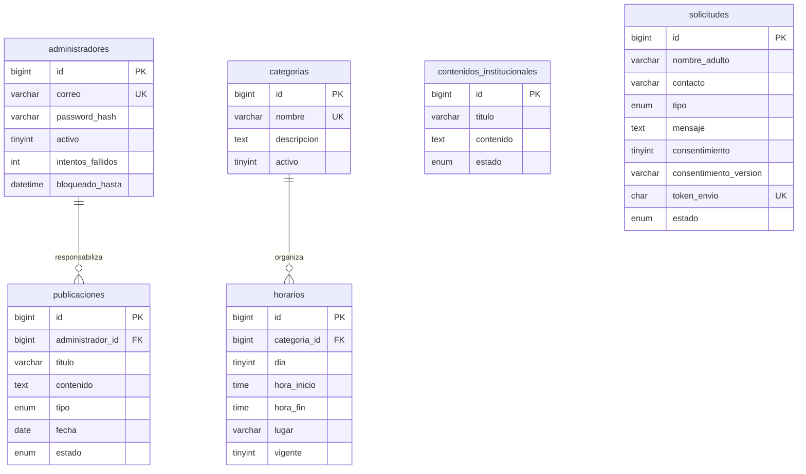

> Documento histórico de la versión 1 (11/11/2026). Para la versión actual con integrantes, roles y salud, consultar [integrantes](integrantes.md), [migración v2](migracion-v2.md) y [pruebas v2](pruebas-v2.md). Las restricciones y funciones descritas aquí corresponden al alcance anterior.

# Modelo relacional

SQL ejecutable en `database/schema.sql`, datos ficticios separados en `database/demo.sql`. Base creada explícitamente por el instalador para impedir importar accidentalmente sobre una base preexistente. InnoDB, UTF-8 multibyte y colación `utf8mb4_unicode_ci`, compatible con MySQL 8.0.16+.

| Tabla | Reglas |
|---|---|
| administradores | Correo único; hash de hasta 255 caracteres; estado activo; bloqueo temporal; creación |
| contenidos_institucionales | Título 140; texto; borrador/publicado; creación y actualización |
| categorias | Nombre 100 único; descripción; activo 0/1; creación y actualización |
| horarios | Categoría obligatoria; día 1–7; final posterior al inicio; lugar 180; vigente 0/1; combinación categoría/día/inicio/lugar única |
| publicaciones | Autor obligatorio; título 160; noticia/actividad; fecha local; borrador/publicado; creación y actualización |
| solicitudes | Adulto ficticio 100; contacto 150; información/preinscripción; aceptación obligatoria; versión demo-v1; token único; pendiente/revisada/cerrada; fechas |

Las FK impiden borrar categorías o administradores referenciados (`RESTRICT`). No se utiliza CASCADE para evitar pérdida accidental. Índices compuestos sirven a las consultas de visibilidad y orden. `CHECK` impone días, estados binarios y orden temporal incluso fuera de los formularios; MySQL anterior a 8.0.16 no satisface este requisito porque no aplica esos CHECK.

Las solicitudes no se vinculan a menores, deportistas ni categorías; no se recopilan datos deportivos individuales. El administrador de publicaciones representa al responsable de la última edición guardada, no un historial completo. Un cambio en la categoría activa afecta inmediatamente la visibilidad de todos sus horarios sin modificar sus registros.

No se incluyen administradores ni contraseñas en `demo.sql`. La importación requiere crear primero uno por CLI y lo asigna como autor de las dos publicaciones demostrativas.
